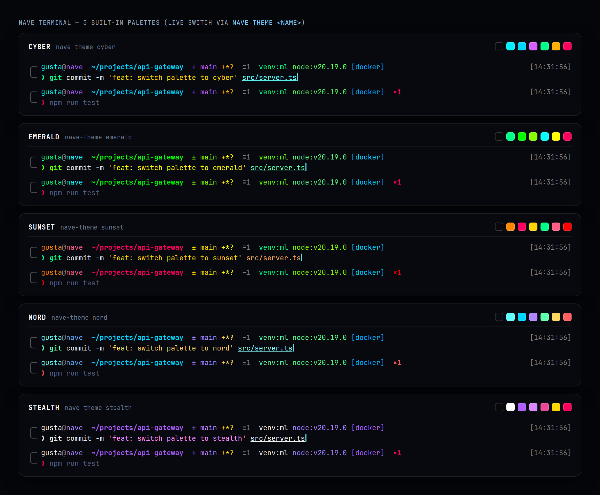

<div align="center">

# Nave Terminal

**Tema Zsh + Toolkit WSL2 moderno, rápido e 100% imune a caracteres/emojis quebrados.**

[](https://www.zsh.org/)
[](https://learn.microsoft.com/windows/wsl/)
[]()
[](LICENSE)

</div>

---

<p align="center">
  
</p>

## Destaques

Construído para ser rápido, legível e consistente em qualquer visualizador (Windows Terminal, VS Code, Cursor, Antigravity, ConHost ou SSH), usando apenas Box Drawing (`╭─`, `╰─`, `█`, `░`) e Unicode padrão (`❯`, `±`, `↑`, `↓`, `≡`, `×`):

- **Renderização limpa em qualquer terminal**: sem glifos proprietários que viram `□□□` ou emojis que desalinharam o cursor.
- **Transient Prompt**: após pressionar Enter, prompts antigos colapsam para uma única linha minimalista (`HH:MM ❯ comando`), mantendo o foco no comando atual.
- **5 paletas integradas com troca ao vivo** (`nave-theme`): sincroniza automaticamente o prompt, `zsh-syntax-highlighting`, `fzf` e `sysinfo`.
- **Contexto inteligente**: truncamento automático de diretórios profundos, status Git completo (`± branch`, `+` staged, `*` dirty, `?` untracked, `↑`/`↓` ahead/behind, `≡N` stashes, `MERGE`/`REBASE`), `venv`/`conda`, `node` e `[docker]`.
- **Notificações nativas no Windows**: comandos demorados (`>= 15s`) disparam um toast assíncrono do Windows avisando se concluiu com sucesso ou erro.
- **Toolkit WSL + Dev pronto**: hub de projetos fuzzy (`p`), radar de portas (`ports` / `killport`), ponte WSL ↔ Windows (`clip`, `paste`, `winopen`, `winip`), Git turbo (`ginfo`, `gbf`, `gwip`, `gbclean`) e Docker cockpit (`dks`, `dkl`, `dksh`).

---

## Paletas integradas

Troque a qualquer momento com `nave-theme <nome>` — a escolha fica salva em `~/.config/nave/palette` e atualiza o terminal instantaneamente.

<p align="center">
  
</p>

| Paleta | Comando | Estilo |
| :--- | :--- | :--- |
| **Cyber** *(padrão)* | `nave-theme cyber` | Cyan elétrico, roxo e verde menta inspirado em Tokyo Night |
| **Emerald** | `nave-theme emerald` | Verde neon e teal de alto contraste |
| **Sunset** | `nave-theme sunset` | Laranja quente, coral e magenta |
| **Nord** | `nave-theme nord` | Azul ártico, gelo e tons suaves |
| **Stealth** | `nave-theme stealth` | Monocromático minimalista com foco apenas em alertas e erros |

---

## Cockpit & Ferramentas integradas

### `sysinfo` & `ginfo`
Monitor visual de RAM/SSD com barras de progresso em Unicode padrão, contagem de portas TCP, containers Docker e painel completo do repositório Git atual:

<p align="center">
  
</p>

### `nave-help`
Guia rápido embutido no próprio shell com todos os comandos e atalhos:

<p align="center">
  
</p>

---

## Instalação rápida

### Pré-requisitos
- `zsh` e [Oh My Zsh](https://ohmyz.sh/)
- `git` e `curl` (e `python3` se quiser instalar os binários CLI modernos automaticamente)

### 1. Clone e execute o instalador

```bash
git clone https://github.com/gustavolafz/nave-terminal.git
cd nave-terminal

# Instala tema + toolkit + plugins Zsh (zsh-autosuggestions e zsh-syntax-highlighting)
./install.sh

# Opcional: também baixa fzf, zoxide, bat, eza, delta, lazygit, btop, fd e rg em ~/.local/bin (sem sudo)
./install.sh --with-cli
```

### 2. Ative no seu `~/.zshrc`

Use [config/zshrc.example](config/zshrc.example) como referência ou garanta estas linhas no seu `~/.zshrc`:

```zsh
export PATH="$HOME/.local/bin:$PATH"
export NAVE_PROJECTS_DIR="$HOME/projects"   # pasta usada pelo comando `p`

ZSH_THEME="nave"
plugins=(git zsh-autosuggestions zsh-syntax-highlighting)
source "$ZSH/oh-my-zsh.sh"

[[ -r "$HOME/.config/nave/toolkit.zsh" ]] && source "$HOME/.config/nave/toolkit.zsh"
```

Depois recarregue o shell:

```zsh
source ~/.zshrc
nave-help
```

### 3. Extras opcionais

<details>
<summary><strong>Git Delta (diff lado a lado colorido)</strong></summary>

Adicione o conteúdo de [config/gitconfig.delta](config/gitconfig.delta) ao seu `~/.gitconfig`:

```ini
[core]
	pager = delta
[interactive]
	diffFilter = delta --color-only
[delta]
	navigate = true
	side-by-side = true
	line-numbers = true
	syntax-theme = TwoDark
	hyperlinks = true
```
</details>

<details>
<summary><strong>PowerShell (Windows 5.1 &amp; PowerShell 7+)</strong></summary>

O mesmo visual (2 linhas, 5 paletas com `nave-theme`, Git, `sysinfo`, `ginfo`, `ports`, `killport` e `PSReadLine` colorido) também funciona nativamente no PowerShell:

```powershell
# 1. Copie powershell/nave.ps1 para %USERPROFILE%\.config\nave\nave.ps1
New-Item -ItemType Directory -Path "$env:USERPROFILE\.config\nave" -Force | Out-Null
Copy-Item .\powershell\nave.ps1 "$env:USERPROFILE\.config\nave\nave.ps1"

# 2. Adicione ao seu $PROFILE
New-Item -ItemType File -Path $PROFILE -Force | Out-Null
Add-Content -Path $PROFILE -Value "`n. `"$env:USERPROFILE\.config\nave\nave.ps1`""
```
</details>

<details>
<summary><strong>Windows Terminal — Esquema "Nave Cyber"</strong></summary>

Copie o esquema de [windows-terminal/nave-cyber.json](windows-terminal/nave-cyber.json) para o array `"schemes"` no `settings.json` do Windows Terminal e aplique no seu perfil WSL:

```json
{
  "colorScheme": "Nave Cyber",
  "cursorShape": "bar",
  "padding": "12, 14, 12, 14",
  "opacity": 94,
  "useAcrylic": true,
  "bellStyle": "none"
}
```
</details>

---

## Referência rápida de comandos

| Categoria | Comando / Atalho | O que faz |
| :--- | :--- | :--- |
| **Tema** | `nave-theme <nome>` | Alterna entre `cyber`, `emerald`, `sunset`, `nord`, `stealth` |
| **Tema** | `nave-transient on\|off` | Liga/desliga colapso de prompts antigos após Enter |
| **Tema** | `nave-notify <seg\|off>` | Configura toast do Windows para comandos longos (padrão: `15s`) |
| **Tema** | `nave-welcome on\|off` | Liga/desliga a barra compacta de RAM/SSD ao abrir terminal |
| **Sistema** | `sysinfo` / `ports` / `killport <p>` | Painel do sistema, radar de portas TCP/UDP e encerramento rápido |
| **Navegação** | `p [projeto]` | Pula para `$NAVE_PROJECTS_DIR` com `fzf` + preview Git ou `Tab` |
| **Navegação** | `z <termo>` / `zi` | Salto inteligente para pastas frequentes (`zoxide`) |
| **Busca** | `Ctrl+R` / `Ctrl+T` / `Alt+C` | Histórico fuzzy, arquivos com preview (`bat`) e diretórios (`eza`) |
| **Atalho** | `Esc Esc` | Adiciona ou remove `sudo ` no início da linha atual |
| **Git** | `lg` / `ginfo` / `gbf` | Lazygit, painel do repositório e troca de branch com preview |
| **Git** | `gwip` / `gunwip` / `gbclean` | Commit temporário WIP e remoção de branches locais já mergeadas |
| **Docker** | `dks` / `dkl` / `dksh` | Tabela de containers, logs e shell com seleção interativa via `fzf` |
| **WSL** | `clip` / `paste` / `winopen` / `winip` | Clipboard do Windows, abrir no Explorer e IPs WSL/Host |

---

## Estrutura do repositório

```text
nave-terminal/
├── theme/nave.zsh-theme          # Tema Zsh principal (paletas, transient prompt, Git, toasts)
├── config/toolkit.zsh            # Funções WSL, Git, Docker, portas, projetos e integrações CLI
├── config/zshrc.example          # Exemplo limpo de ~/.zshrc
├── config/gitconfig.delta        # Configuração recomendada para git-delta
├── windows-terminal/             # Esquema de cores Nave Cyber para o Windows Terminal
├── assets/                       # Capturas em alta resolução renderizadas da saída ANSI real
└── install.sh                    # Instalador automático (suporta --with-cli)
```

## Licença

Distribuído sob a licença [MIT](LICENSE).
