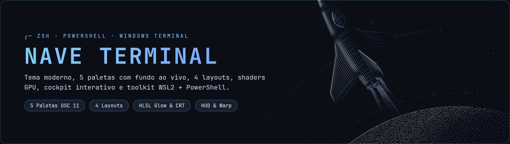

<p align="center">
  
</p>

<div align="center">

[](https://www.zsh.org/)
[](https://learn.microsoft.com/powershell/)
[](https://learn.microsoft.com/windows/wsl/)
[]()
[](LICENSE)

</div>

---

<p align="center">
  
</p>

## Destaques

Construído para ser rápido, legível e consistente em qualquer visualizador (Windows Terminal, VS Code, Cursor, Antigravity, ConHost ou SSH), usando apenas Box Drawing (`╭─`, `╰─`, `█`, `░`) e Unicode padrão (`❯`, `±`, `↑`, `↓`, `≡`, `×`):

- **100% Standalone no Zsh (Zero Oh My Zsh, Zero plugins externos)**: inicializador próprio (`init.zsh` com `compinit` em cache diário), motor nativo de autosuggestions (`nave-suggest`), syntax highlighting em tempo real sincronizado com a paleta (`nave-highlight`) e salto inteligente de diretórios por frecency (`nave-z`). Basta ter `zsh` instalado.
- **Editor de terminal nativo em Rust (`nave-edit` / `ne`, ~780 KB, <3ms de boot)**: buffer Rope UTF-8 próprio, **multi-cursor real estilo VS Code** (`Ctrl+D`, `Ctrl+Shift+L`, `Ctrl+Alt+↑/↓`), lexer multi-linha com estado (14 linguagens + `MatchParen` vibrante + `Alt+M` + auto-close/wrap), **Git gutter assíncrono (`▎`) + salto de hunks (`Alt+]`/`Alt+[`)**, **Estilo Vim Visual (`Alt+V`)** (`relativenumber`, cursor fino com piscar em standby, scrollbar `┃`, `cursorword`, guias de indentação `▏`, `Alt+I` expansão inteligente `vi(`/`, `Alt+B`/`F4` bookmarks `◆`, `·` trailing spaces e régua `colorcolumn`), múltiplas abas + **Quick Open (`Ctrl+P`)**, **word-wrap (`Alt+Z`)**, busca/substituição Regex (`Ctrl+F`) e Command Palette (`F1`).
- **5 paletas + fundo e cursor ao vivo (`OSC 11 / 12`)**: trocar com `nave-theme <nome>` muda instantaneamente o fundo da aba, cursor, prompt, `nave-highlight`, `PSReadLine`, `fzf` e `sysinfo`.
- **4 layouts de prompt (`nave-layout`)**: alterne entre `framed`, `rail` (trilho contínuo até o relógio), `hud` (divisores geométricos `◆ │`) e `compact` (1 linha para split panes).
- **Transient Prompt**: após pressionar Enter, prompts antigos colapsam para uma única linha minimalista (`HH:MM ❯ comando`).
- **Arte TrueColor + Cockpit em tempo real**: `sysinfo` com foguete em gradiente dinâmico, régua divisória `hr [titulo]`, dashboard interativo `nave-hud` e starfield 3D `nave-warp`.
- **Acabamento nativo no Windows Terminal**: 5 esquemas de cor, wallpaper minimalista espacial sob medida e 2 pixel shaders GPU em HLSL (`nave-glow.hlsl` e `nave-crt.hlsl`) alternáveis via `nave-shader`.
- **Edição de texto estilo VS Code no Zsh (`config/keybindings.zsh`) e PowerShell**: seleção pelo teclado (`Shift+Setas`, `Ctrl+Shift+Setas`, `Shift+Home/End`, `Ctrl+A`, `Ctrl+L`, `Ctrl+D` selecionando palavra sem fechar o shell), digitar/colar substitui a seleção, navegação por subpalavra (`WORDCHARS=''`), `Ctrl+Z` / `Ctrl+Y` / `Ctrl+Shift+Z`, `Ctrl+C` inteligente (cancela sem seleção, copia com seleção), `Ctrl+X`, `Ctrl+Space` (autocomplete), `Shift+Enter` (quebra de linha), `Shift+Alt+↓` / `Ctrl+Shift+D`, `Ctrl+Shift+K`, `Ctrl+/` (e `Ctrl+;` ABNT2), `Ctrl+F`, `Alt+L` e `Alt+E`.
- **Toolkit WSL2 + PowerShell**: notificações toast no Windows para comandos longos (`>= 15s`), hub de projetos fuzzy (`p`), radar de portas (`ports` / `killport`), ponte WSL ↔ Windows (`clip`, `paste`, `winopen`, `winip`), Git turbo (`ginfo`, `gbf`, `gwip`, `gbclean`) e Docker cockpit (`dks`, `dkl`, `dksh`).

---

## Showcase principal

<p align="center">
  
</p>

## Paletas integradas

Troque a qualquer momento com `nave-theme <nome>` — a escolha fica salva em `~/.config/nave/palette` e sincroniza inclusive o fundo da janela (`nave-bg on|off`).

<p align="center">
  
</p>

| Paleta | Comando | Background (OSC 11) | Estilo |
| :--- | :--- | :---: | :--- |
| **Cyber** *(padrão)* | `nave-theme cyber` | `#08090F` | Obsidiana profunda com ciano elétrico, violeta e magenta neon |
| **Emerald** | `nave-theme emerald` | `#070C09` | Obsidiana escura com esmeralda ácido, ciano e verde-lima |
| **Sunset** | `nave-theme sunset` | `#0C070A` | Obsidiana magma com ouro solar, laranja vivo e rosa carmim |
| **Nord** | `nave-theme nord` | `#080B12` | Obsidiana aurora com azul elétrico, gelo vibrante e lavanda |
| **Stealth** | `nave-theme stealth` | `#08080B` | Obsidiana pura com roxo ametista vibrante e branco cristalino |

---

## Arte, Cockpit & Ferramentas

### `sysinfo`, `hr` e `ginfo`
Arte espacial em gradiente TrueColor dinâmico (acompanha a paleta ativa), régua divisória para logs (`hr`) e painel completo do repositório Git:

<p align="center">
  
</p>

### `nave-hud` (Cockpit em tempo real)
Tela cheia interativa com relógio em blocos gradiente, sparkline histórico de CPU, barras de RAM/SSD e telemetria de rede/Docker (use `1–5` para trocar a paleta ao vivo e `q` para sair). Experimente também `nave-warp` para o starfield 3D.

<p align="center">
  
</p>

### `nave-help`
Guia rápido embutido no próprio shell:

<p align="center">
  
</p>

---

## Instalação rápida

### WSL / Linux (Zsh 5.9+ — Zero Oh My Zsh)

```bash
git clone https://github.com/gustavolafz/nave-terminal.git
cd nave-terminal

# Instala o Nave Shell Core completo (zero Oh My Zsh, zero plugins externos)
./install.sh

# Opcional: também baixa fzf, bat, eza, delta, lazygit, btop, fd e rg em ~/.local/bin (sem sudo)
./install.sh --with-cli
```

Adicione no seu `~/.zshrc` (referência completa em [config/zshrc.example](config/zshrc.example)):

```zsh
export PATH="$HOME/.local/bin:$PATH"
export NAVE_PROJECTS_DIR="$HOME/projects"   # pasta usada pelo comando `p`

[[ -r "$HOME/.config/nave/init.zsh" ]] && source "$HOME/.config/nave/init.zsh"
```

Recarregue o shell:

```zsh
source ~/.zshrc
nave-help
```

### Extras (PowerShell, Windows Terminal & Git Delta)

<details>
<summary><strong>PowerShell (Windows 5.1 &amp; PowerShell 7+)</strong></summary>

O mesmo visual (4 layouts, 5 paletas com OSC 11/12 ao vivo, arte gradiente no `sysinfo`, `hr`, `ginfo`, `ports`, `killport`, `nave-shader` e `PSReadLine` sincronizado) funciona nativamente no PowerShell:

```powershell
New-Item -ItemType Directory -Path "$env:USERPROFILE\.config\nave" -Force | Out-Null
Copy-Item .\powershell\nave.ps1 "$env:USERPROFILE\.config\nave\nave.ps1"

New-Item -ItemType File -Path $PROFILE -Force | Out-Null
Add-Content -Path $PROFILE -Value "`n. `"$env:USERPROFILE\.config\nave\nave.ps1`""
```
</details>

<details>
<summary><strong>Windows Terminal — 5 Esquemas, Wallpaper &amp; Pixel Shaders HLSL</strong></summary>

1. Copie `windows-terminal/nave-wallpaper.png` e `windows-terminal/shaders/*.hlsl` para `%USERPROFILE%\.config\nave\`.
2. Adicione os 5 esquemas de [windows-terminal/schemes.json](windows-terminal/schemes.json) em `"schemes"` no `settings.json` do Windows Terminal.
3. No seu perfil WSL / PowerShell, configure:

```json
{
  "colorScheme": "Nave Cyber",
  "cursorShape": "bar",
  "padding": "12, 14, 12, 14",
  "opacity": 95,
  "useAcrylic": true,
  "bellStyle": "none",
  "backgroundImage": "C:\\Users\\SEU_USUARIO\\.config\\nave\\nave-wallpaper.png",
  "backgroundImageOpacity": 0.68,
  "backgroundImageStretchMode": "uniform",
  "backgroundImageAlignment": "bottomRight",
  "experimental.pixelShaderPath": "C:\\Users\\SEU_USUARIO\\.config\\nave\\shaders\\nave-glow.hlsl"
}
```

Depois você pode alternar o shader direto pelo terminal com `nave-shader glow`, `nave-shader crt` ou `nave-shader off`.

Para habilitar também `Ctrl+Shift+Z` (refazer), `Ctrl+Shift+K` (apagar linha), `Ctrl+Shift+L` (multi-cursor em todas as ocorrências no `nave-edit`), `Shift+Alt+↓/↑` / `Ctrl+Shift+D` (duplicar), `Shift+Enter` (quebra de linha) e `Ctrl+;`/`Ctrl+/` (comentar) no Windows Terminal (mantendo busca da aba em `Ctrl+Shift+F` para liberar `Ctrl+F` ao editor), adicione em `"actions"` e `"keybindings"` do `settings.json`:

```json
"actions": [
  { "id": "Nave.redo",                 "command": { "action": "sendInput", "input": "\u001b[90;6u" } },
  { "id": "Nave.deleteLine",           "command": { "action": "sendInput", "input": "\u001b[75;6u" } },
  { "id": "Nave.duplicate",            "command": { "action": "sendInput", "input": "\u001b[68;6u" } },
  { "id": "Nave.selectAllOccurrences", "command": { "action": "sendInput", "input": "\u001b[76;6u" } },
  { "id": "Nave.dupDown",              "command": { "action": "sendInput", "input": "\u001b[1;4B" } },
  { "id": "Nave.dupUp",                "command": { "action": "sendInput", "input": "\u001b[1;4A" } },
  { "id": "Nave.shiftEnter",           "command": { "action": "sendInput", "input": "\u001b\r" } },
  { "id": "Nave.comment",              "command": { "action": "sendInput", "input": "\u001b[47;5u" } }
],
"keybindings": [
  { "id": "Nave.redo",                 "keys": "ctrl+shift+z" },
  { "id": "Nave.deleteLine",           "keys": "ctrl+shift+k" },
  { "id": "Nave.duplicate",            "keys": "ctrl+shift+d" },
  { "id": "Nave.selectAllOccurrences", "keys": "ctrl+shift+l" },
  { "id": "Nave.dupDown",              "keys": "alt+shift+down" },
  { "id": "Nave.dupUp",                "keys": "alt+shift+up" },
  { "id": "Nave.shiftEnter",           "keys": "shift+enter" },
  { "id": "Nave.comment",              "keys": "ctrl+oem_2" }
]
```
</details>

<details>
<summary><strong>Git Delta (diff lado a lado colorido)</strong></summary>

Adicione o conteúdo de [config/gitconfig.delta](config/gitconfig.delta) ao seu `~/.gitconfig`:

```ini
[core]
	pager = delta
[interactive]
	diffFilter = delta --color-only
[delta]
	navigate = true
	side-by-side = true
	line-numbers = true
	syntax-theme = TwoDark
	hyperlinks = true
```
</details>

---

## Referência rápida de comandos

| Categoria | Comando / Atalho | O que faz |
| :--- | :--- | :--- |
| **Estilo** | `nave-theme <nome>` | Alterna paleta + fundo/cursor OSC 11 (`cyber`, `emerald`, `sunset`, `nord`, `stealth`) |
| **Estilo** | `nave-layout <modo>` | Muda desenho do prompt (`framed`, `rail`, `hud`, `compact`) |
| **Estilo** | `nave-shader <modo>` | Alterna pixel shader GPU do Windows Terminal (`glow`, `crt`, `off`, `status`) |
| **Estilo** | `nave-transient` / `nave-bg` / `nave-welcome` | Liga/desliga transient prompt, fundo dinâmico e welcome bar |
| **Arte & HUD** | `sysinfo` / `hr [titulo]` | Painel com arte gradiente TrueColor / régua divisória na largura da tela |
| **Arte & HUD** | `nave-hud` / `nave-warp` | Cockpit em tela cheia em tempo real / starfield 3D interativo |
| **Editor** | `ne <arq[:lin]>` (`nave-edit`) | Editor nativo em Rust estilo VS Code (multi-cursor, Git gutter, `Ctrl+P`, `Ctrl+F`, `Alt+Z`, `F1`) |
| **Sistema** | `ports` / `killport <porta>` | Radar de portas TCP/UDP abertas e encerramento rápido |
| **Navegação** | `p [projeto]` / `z <termo>` / `zi` / `z -l` | Hub fuzzy de projetos em `$NAVE_PROJECTS_DIR` e salto nativo por frecency (`nave-z`) |
| **Motor Zsh** | `nave-suggest` / `nave-highlight` | Liga/desliga autosuggestions e syntax highlighting nativos do Nave (zero plugins externos) |
| **Busca** | `Ctrl+R` / `Ctrl+T` / `Alt+C` | Histórico fuzzy, arquivos com preview (`bat`) e diretórios (`eza`) |
| **Edição** | `Shift+Setas` / `Ctrl+A` / `Ctrl+L` | Seleciona texto ou linha inteira (digitar, colar ou Backspace substitui) |
| **Edição** | `Ctrl+D` / `Ctrl+Space` / `Shift+Enter` | Seleciona palavra (2x expande argumento; não fecha o shell) / Autocomplete / Quebra de linha |
| **Edição** | `Ctrl+←/→` / `Ctrl+BS` / `Ctrl+Del` | Navega e apaga por subpalavra/pasta (`/` `-` `_` `.` `=` `:`) |
| **Edição** | `Ctrl+Z` / `Ctrl+Y` / `Ctrl+Shift+Z` | Desfazer e refazer edições na linha de comando |
| **Edição** | `Ctrl+C` / `Ctrl+X` / `Alt+W` | Cancela linha (ou copia se houver seleção) / Recorta para o clipboard Windows |
| **Edição** | `Shift+Alt+↓` / `Ctrl+Shift+K` / `Ctrl+/` | Duplica / apaga linha / comenta com `#` (inclui `Ctrl+;` no ABNT2) |
| **Edição** | `Ctrl+F` / `Alt+L` / `Alt+E` | Busca na aba (WT) / limpa tela / abre comando no `$EDITOR` |
| **Atalho** | `Esc Esc` | Adiciona ou remove `sudo ` no início da linha atual |
| **Git** | `lg` / `ginfo` / `gbf` / `gwip` / `gbclean` | Lazygit, painel do repo, troca de branch fuzzy, WIP e limpeza de branches |
| **Docker** | `dks` / `dkl` / `dksh` | Tabela de containers, logs e shell com seleção interativa via `fzf` |
| **WSL** | `clip` / `paste` / `winopen` / `winip` / `notify` | Clipboard Windows, Explorer, IPs e notificações toast nativas |

---

## Estrutura do repositório

```text
nave-terminal/
├── theme/nave.zsh-theme               # Motor de prompt v4 (paletas OSC 11/12, 4 layouts, transient, toasts)
├── config/init.zsh                    # Bootstrap standalone do Nave Shell (substitui Oh My Zsh)
├── config/highlight.zsh               # nave-highlight: syntax highlighting nativo em Zsh 5.9
├── config/suggest.zsh                 # nave-suggest: autosuggestions nativo em Zsh 5.9 (full + subword)
├── config/z.zsh                       # nave-z: salto de diretórios por frecency (substitui zoxide)
├── config/keybindings.zsh             # Edição estilo VS Code no Zsh (seleção, Ctrl+D/L/Space, undo/redo)
├── config/toolkit.zsh                 # Arte gradiente, hr, nave-shader, WSL, Git, Docker, projetos
├── config/zshrc.example               # Exemplo limpo de ~/.zshrc (1 linha de carregamento)
├── config/gitconfig.delta             # Configuração recomendada para git-delta
├── bin/nave-hud                       # Cockpit interativo em tela cheia (relógio + CPU sparkline)
├── bin/nave-warp                      # Starfield 3D interativo sincronizado com a paleta
├── editor/                            # nave-edit: editor de terminal nativo em Rust (Rope, multi-cursor, Git gutter)
├── powershell/                        # Versão nativa completa para Windows PowerShell 5.1 e 7+
├── windows-terminal/
│   ├── schemes.json                   # Os 5 esquemas de cor do Windows Terminal
│   ├── nave-wallpaper.png             # Wallpaper minimalista espacial customizado
│   └── shaders/                       # Pixel shaders HLSL (nave-glow.hlsl e nave-crt.hlsl)
├── assets/                            # Banner, GIF animado e capturas em alta resolução
└── install.sh                         # Instalador automático (suporta --with-cli)
```

## Licença

Distribuído sob a licença [MIT](LICENSE).
